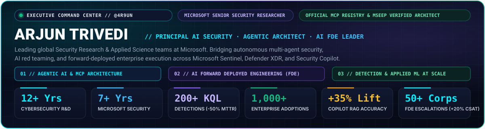

# 🌐 Arjun Trivedi (`@4R9UN`) — Executive AI Security, Agentic Architecture & AI FDE Portfolio

**Live URL:** [https://4r9un.github.io](https://4r9un.github.io)

<p align="center">
  
</p>

## ⚡ Overview

Zero-build-step, high-performance **Cyber-Executive Command Center** portfolio website for **Arjun Trivedi (`@4R9UN`)** — Senior Security Research Leader at Microsoft (12+ years in Cybersecurity, 7+ years at Microsoft, leading global Security Research & Applied Science teams across Agentic AI, Detection Engineering, and AI Forward Deployed Engineering).

### Key Interactive Features
- **Recruiter Role-Lens Switcher:** Dynamically filters and spotlights accomplishments across four executive lenses:
  - *All Executive Capabilities*
  - *AI Security & Agentic Architect*
  - *AI Forward Deployed Engineering (FDE) Leader*
  - *Director / Head of Detection & Threat Research*
- **Interactive 4-Stage Agentic Security Pipeline:** Clickable architecture inspector covering *Telemetry & CTI Ingestion*, *MCP Context & Grounding*, *Multi-Agent Reasoning & AI Red Teaming*, and *Enterprise Production Impact*.
- **Flagship Production Systems Showcase:** Filterable cards + architecture specification modals for **ASRS** ([Live Demo](https://asrs-demo-v1.vercel.app/)), **`mcp-kql-server`** (PyPI v2.1.5, Official MCP Registry), **`fastmcp-threatintel`** (PyPI v0.2.7, MseeP Verified), **`Assured-Arc`**, **Multi Cloud Attack Coverage Essentials** (`1,000+` enterprises), and **PromptBook**.
- **Executive CV Download:** Includes direct download for `assets/Arjun_Trivedi_Executive_AI_Security_Leader_CV_2026.pdf`.

## 🗂️ Repository Structure

```text
4R9UN.github.io/
├── index.html                                                # Cyber-Executive Command Center SPA
├── styles.css                                                # Obsidian glassmorphic design system & animations
├── app.js                                                    # Role-Lens switcher, pipeline inspector, modals & canvas telemetry
├── assets/
│   ├── Arjun_Trivedi_Executive_AI_Security_Leader_CV_2026.pdf # Downloadable Executive CV
│   ├── hero-command-center.svg                               # Executive banner SVG
│   ├── agentic-security-workflow.svg                         # 4-stage Agentic Security workflow SVG
│   └── fde-execution-loop.svg                                # AI Forward Deployed Engineering flywheel SVG
└── README.md
```
