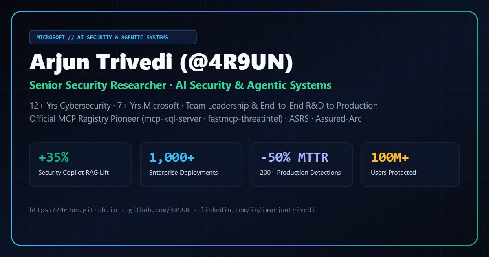

# 🌐 Arjun Trivedi (`@4R9UN`) | AI Security, Agentic Architecture & Detection Engineering Portfolio

**Live URL:** [https://4r9un.github.io/](https://4r9un.github.io/) · **Agent Index (`llms.txt`):** [https://4r9un.github.io/llms.txt](https://4r9un.github.io/llms.txt) · **Markdown Dossier:** [https://4r9un.github.io/index.md](https://4r9un.github.io/index.md)

<p align="center">
  
</p>

## ⚡ Overview

Zero-build-step **Executive AI Security & Agentic Architecture** portfolio for **Arjun Trivedi (`@4R9UN`)**, Senior Security Researcher at Microsoft (12+ years in Cybersecurity, 7+ years at Microsoft, experienced in leading and managing global multidisciplinary detection engineering and security research teams and shipping products end-to-end from research prototype to enterprise scale).

### Key Interactive Features
- **`⌘K` / `Ctrl+K` Executive Command Palette:** Keyboard-navigable action launcher to jump across sections, launch live sandboxes, copy PyPI/PowerShell commands, open LinkedIn/GitHub, or switch between **Obsidian Dark** and **Editorial Light** themes.
- **Interactive Cross-Plane Attack Graph Lab:** Compare *Siloed Point Alerts* vs. *Multi-Agent Cross-Plane Attack Graph + Independent Evidence & Critic Gates* across 6 clickable MITRE ATT&CK and OWASP LLM nodes.
- **4-Lens Mandate Switcher:** Dynamically spotlights capabilities across *All Capabilities*, *Principal / Head of AI Security*, *AI Forward Deployed Engineering (FDE)*, and *Director of Detection & Research*.
- **Stage-Synced 4-Stage Pipeline & 60s Stack:** Clickable architecture schematic synced directly to runnable terminals for **`mcp-kql-server`** (Official MCP Registry), **`fastmcp-threatintel`** (PyPI + STIX 2.1), **[ASRS Live Demo](https://asrs-demo-v1.vercel.app/)**, and **`Assured-Arc`** (`29` lazy-loaded skills across VS Code, Copilot CLI, and Claude Code).
- **Executive CV & Competency Matrix:** Direct download for `assets/Arjun_Trivedi_Executive_AI_Security_Leader_CV_2026.pdf` plus a 5-domain technical & leadership stack matrix.

## 🗂️ Repository Structure & AI / LLM Discovery Endpoints

```text
4R9UN.github.io/
├── index.html                                                # Executive Portfolio + @graph JSON-LD + Semantic Tables + Q&A
├── index.md                                                  # Clean Markdown mirror (<link rel="alternate" type="text/markdown">)
├── llms.txt                                                  # llmstxt.org v2 Agent Index (<link rel="describedby">)
├── llms-full.txt                                             # Complete single-pass LLM & Recruiter Markdown dossier
├── robots.txt                                                # Explicit Allow policy for OAI-SearchBot, ClaudeBot, PerplexityBot, Googlebot, Bingbot
├── sitemap.xml                                               # XML Sitemap covering HTML, Markdown, llms.txt & Executive CV PDF
├── styles.css                                                # Obsidian Dark & Editorial Light design system
├── app.js                                                    # Cmd+K Command Palette, Attack Graph Lab, Role-Lens & Stage Switcher
├── assets/
│   ├── Arjun_Trivedi_Executive_AI_Security_Leader_CV_2026.pdf # Downloadable Executive CV
│   ├── og-card.png                                           # 1200x630 OpenGraph / LinkedIn / X social preview card
│   ├── arjun-avatar.jpg                                      # Executive portrait
│   └── fde-execution-loop.svg                                # AI Forward Deployed Engineering flywheel SVG
└── README.md
```
